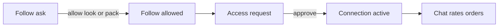

# Shared concepts

## Purpose

Vocabulary and trust rules that every feature assumes. Read this before catalog, Explore, access, or chat docs.

## Who uses it

Everyone on the platform — buyers, sellers, and dual-role companies.

## Core model

| Concept | Meaning |
|---------|---------|
| **Company account** | The trading entity. Product pitch is one company, no “are you a buyer or seller?” role enum. |
| **Contact person** | The logged-in user’s display name (e.g. Ravi) — distinct from the **business name** (e.g. Surat Silk House). |
| **Capabilities** | Stored flags: `publish`, `relist`, `refer`. Unlock progressively; never a role picker. |
| **Trade presence** | `buyingEnabled` / `sellingEnabled` still shape ＋ and Home. Not shown on You or Edit. Creating catalog content turns selling back on. |
| **Edit** | Manage my business / profile / content. Home avatar **Profile** is look-first; **Edit profile** unlocks fields. Not Settings. |
| **Share** | Share my Ekum identity (chat + OS share). Not a social post. |
| **Settings** | Configure Ekum. Domain cards only — add a link to a domain or add a domain. Not Edit. |

Membership roles (`owner` / `staff`) and five caps (`uploads` · `chats` · `orders` · `payments` · `team`) sit on the person × company seat. The **company** still trades. **Settings → Team** invites staff by phone. One **live** membership at a time; after archive, the same phone may join another shop (or create a company). Counterparties see the business name. New chats start with **owners**; staff see a thread only after an owner adds them. Do not label chats Private or Team.

## App chrome (phone column)

Ekum is **mobile-first**. On a laptop the app is a centred **phone column** (`max-w-md`) on a quiet stage; the **window does not scroll**. Scroll lives inside that column so the scrollbar sits on the phone frame, not the browser edge. On a real phone the stage matches the canvas (no side gutters).

## App updates (PWA)

Installed Ekum keeps a service worker. After a deploy, the open screen shows **New version · Load** on its own (poll while visible). It never reloads by itself. See [Settings](./settings.md#app-update-installed--pwa).

## Platform & dual-network companies

Ekum is a **wholesale platform**, not a single-hop shop:

- Every company **knows its own sellers and its own buyers** (direct upstream / downstream).
- Goods may travel a **long chain** (mill → wholesaler → trader → retailer …). Each hop is a company that may curate, publish, and trade.
- Counterparties appear as normal **businesses** — no Trader / Seller badges; buyers often need not know whether a publisher is a mill or a middleman.
- UI works **1-hop** relationships by default; full-chain map is not forced on every screen.

Some companies are dual-network (**traders** in product language only): buy, curate, share, follow up — still one company account, no OTP “Trader” role. Capability **`relist`** is the product gate for curated publish from others’ catalogs.

| Intent | Rule (much of this is **planned**, not shipped) |
|--------|--------------------------------------------------|
| Curate | Pick designs/collections from one or more suppliers into a **curated collection** for their buyers |
| Saved | **Reference** shortlist of designs/collections (not a copy catalog); hub under You; feeds Curate collection — see Slice A design |
| Publish | Same audience model as any publish — **Explore is not supplier-only** |
| Permission ceiling | Cannot outrun the **original seller’s** audience / **buyers can forward** lock |
| Forward vs Curate | **Forward** = share someone’s card as-is; **Curate** = assemble into **your** collection then publish (still under source ceiling) |
| Stories | Viewer sees a company when they are an **allowed** follower or are connected and it has **published** to feed (own or curated) |
| Explore trade-side | **All** (default) · **Buying** · **Selling** — see [explore](./explore.md) |
| Surfaces | **Home** = light **New collections** (curated received, 7 days / 5); **Buying** Explore = followed posts + received by day/business |
| Dual trade | Company may **buy/pay upstream** and **sell/send orders downstream**. **Trading** gates Curate + TradeLane (not a Profile switch). Product default off (QA may treat unset as on). Linking/split in Slice B |
| Orders | First middle-hop pair: **I handle**, no group. Lane = **Buyer talks to** (You / mill) × **Share a group**. Tweak on **You** / order page / Your paths — not on everyday Place. Soft-hide when group Off; group when On. Mill **Send** on the card; mill **Confirm** (qty + optional rate) / Decline on the mill ticket — no **Send quote** button; **Handle myself** when flipping Direct to your desk |

See [mvp-garmenthub-gap-matrix.md](../superpowers/reviews/mvp-garmenthub-gap-matrix.md) for Keep / Missing / slice tracking.

## Trust ladder

| Mechanism | What it is |
|-----------|------------|
| **Request access** | Shop ask (was Follow / See new collections). Idle: lock + **Request access**. Pending: lock + **Requested** (outline; tap cancels). Owner **Allow** (default: they can see my collections) or **Decline**. Collection share is a later checkbox / Followers Change. Allowed: unlock + **Has access** — tap off deletes the follow. No Followers feed or Followers shop collections after that (Connection does not keep them). Does **not** unlock Connection. They never see which grant. Shop **⋯ → Remove connection** is the same unfollow / cancel-ask. |
| **Message** | First shop chat. Recipient **Approve** → chat + **Connection**. After that the shop says **Chat**. Stays on the shop even from a 1:1. **Ignore** hides the thread. **Block** (More) is silent Network block. No shop **Request** button. |
| **Access request** | Still used from invites / Find on Ekum. Shop path is **Message**. Incoming Approve is **Chats → Requests** (same Connection as first-write Approve). |
| **Collection view Ask** | **Ask to see this collection** — open designs to look through. Owner Allow → **Granted on request** (not Connection, not collection/relist). Deny silent. |
| **Collection / relist Ask** | **Ask to put in my collection** — unlock Curate when collection permission is off. Distinct chat card (“wants to put … in their collection”). Never bare **Ask**. Via **your** collection → **you** decide (your publish allow); via mill’s own post → mill. Mill Allow ≠ chain free pass. |
| **Connect invite** | Open referral link (`/r/:token`) — redeem sends an access request to the sender (they approve); targeted vouch still needs the target’s approve. |
| **Connection** | After approve: **one mutual pair** (`active`) — both companies are Connected. Each can see the other’s published shop content that Connection unlocks (Connections-audience included; Selected stays Selected). **Either** side can **block** (silent). **Only the company that blocked can unblock.** Chat noise is **Mute**, not a Connection pause. |
| **Block** | Other party is not told and does not see the connection row. Shop/API **404** where relevant. Approve never reactivates a block — the **blocker** must **unblock** first. |

## Catalog lifecycle

| Status | Designs | Collections |
|--------|---------|-------------|
| **Draft** | Private library work-in-progress | Album work-in-progress |
| **Published** | On the company shop | Live for buyers only inside `startsAt`/`endsAt` window |
| **Archived** | Ended / out of season | Ended / out of season |

### Collection live window & badges

| Field | Meaning |
|-------|---------|
| `startsAt` null | Live as soon as published |
| `endsAt` null | **Evergreen** (no scheduled hide) |
| Past `endsAt` | Same as Hide → **draft** (job + read guards; not auto-archive) |

Seller My Catalog badges: **Draft** · **Starts…** · **Live** (+ **Evergreen** or **Ends…**) · **Archived**.

### Publish = Explore

| Action | Effect |
|--------|--------|
| **Publish** | Design or collection goes live for the chosen **audience**. **Design** Publish sets `postedToMarketAt` (standalone Explore tile). **Collection** Publish puts the **collection** on Explore and marks own draft members **Published** for trade inside the collection **without** setting `postedToMarketAt` (no design-tile flood). First-ever publish requires **consent to sell** → sets `canPublish`. |
| **Visibility** | Same sheet as publish — change who can see it / rates / forward without a separate “post” step. |
| **Hide / unpublish** | Returns to draft; design Explore post is cleared (`postedToMarketAt` null). Collection hide clears `exploreActivityAt`. |

### Audience, rates & forward

When publishing (or updating visibility), the sheet sets:

| Field | Values | Default practice |
|-------|--------|------------------|
| **Audience** | API: `everyone` · `connections` · `followers` · `selected` (+ company IDs and optional **Buyer group(s)**). **Publish / Visibility UI:** **My followers** · **Selected** only (no Everyone). Legacy `everyone` / `connections` rows are **migrated and enforced as Followers** (same as the sheet chip — no “hidden Everyone” until save). Not My connections — connections mix suppliers. | Followers |
| **Rate visibility** | `visible` · `on_request` | On request (or company usual) |
| **Buyers can add these designs to their collections** | checkbox (on by default) | Uncheck = lock **Curate / relist** only. **Forward** stays free |

| Audience | Who sees on Explore |
|----------|---------------------|
| Everyone | Legacy value only — not offered on Publish; stored rows + access treated as Followers |
| Connections | Legacy value only — not offered on new Publish; stored rows + access treated as Followers (allowed follow), not Connection |
| Followers | Companies the seller **allowed** to follow (not pending asks; not necessarily connected) |
| Selected | Listed companies / buyer groups |

**Layers (simple):** company usual (last publish remembered in `tradeDefaults.publishDefaults`) → selected buyer-group override(s), **strictest wins** if several → this item’s Publish sheet. Snapshot on `Product.allowForward` / `Collection.allowForward`. `audienceGroupIds` restores which groups were chosen on **Visibility** (expand who later without a second collection). One collection may include many groups (member union); not per-group policies on one card.

**Staff audit:** Product, Collection, and Order store `createdByUserId` / `updatedByUserId` (names on list/detail). Full AuditLog history UI is later.

**Trust:** **Forward / Share** (pass the card as-is) is **free**. **View** is checked when they **open** the collection or design — ask the **catalog owner**, not the last forwarder. **Bookmark** (Saved) is a private shortlist and stays free. **Curate** puts designs in **your** album (My designs); that needs `allowForward` (product: **allowRelist**). Locked → `RELIST_NOT_ALLOWED`. Snapshot still stored as `allowForward` on Product / Collection. Never claim “exclusive” without the relist gate.

## Designs vs collections

| | Designs | Collections |
|--|---------|-------------|
| Role | First-class library items | Named albums that **group** designs |
| Standalone | Yes — sell or Explore alone | Always made of designs |
| Many-to-many | A design can sit in many collections | — |
| **Kind color** | Clay (`kind-design`) | Steel (`kind-collection`) |

**You** has three sections: **Collections · Catalogs · Designs**. Every company has one **General Collection** (`Collection.kind = general` — identity is this flag, never the name). Unassigned own designs (Draft or Published, not Deleted) belong there. It is leftover storage, not a pack they order (no apply-all, no pack Order and dispatch). **New collection** is always `kind=regular`. **New catalog** (`?kind=catalog`) is always `kind=catalog` + `orderMode` (whole \| pick) — no “Treat as catalog?” checkbox. Own designs in a catalog are exclusive to that catalog (picker = General Collection leftovers). Mill→trader **Curate** may still reuse mill product IDs; orders on that catalog follow its whole / pick. Lifecycle is **Draft · Published · Deleted** (soft `archived`). No Ready. No Restore. Delete does not erase rows. See [Catalog](./catalog.md) and [Collections](./collections.md).

**Platform kind colors** (object type, not status): **Order** teal (brand accent) · **Collection** steel · **Design** clay. Shared via `kindTone` / CSS `--color-kind-*`. Status colors (success / danger / tangerine) stay separate.

See [Catalog](./catalog.md) and [Collections](./collections.md).

## Chrome density

Everyday kit is **WhatsApp-tight**, not 48px everywhere:

| Control | Size |
|---------|------|
| `Button` / `TextInput` / `SearchInput` | 40px tall. Field type stays **16px** (iOS must not zoom). |
| `Chip` | 28px |
| List square (search trailing / sheet Close) | 40×40 |
| Qty / rate beside a design | Stay compact fields; **design thumbs stay 48px**. How many / Edit / Confirm / quote numbers: **14px emphasis tabular-nums** (`designLineChrome`) |
| Quiet info (`InfoHint`) | Circle **i** next to a title or label. Tap shows instructional copy. One icon — change `InfoIcon` / `InfoHint` and every screen follows. Live status stays `Field.hint` under the field. |
| Sell-as (~80% sets / ~20% native) | Platform default (Settings unset too): **order + dispatch journey in sets**, **price / “1 set contains” / billing per Rate per**. Rate per on create is the Category **primary** (first sheet unit) — Readyset **pc**, Fabric/Jobwork **mtr** even when pc is also offered. Billing = sets × pack size × rate when pack size known or obvious (dozen=12); blank set/box/bundle contents → no conversion / no ₹ invent. Niche (lehenga etc.) configures **pc** — rate and qty stay per piece. Same create knobs; not a second app mode. |
| Nav ＋ / camera shutter | Stay 48px |

### Typography weights

Single face: **Inter** (`--font-sans`). Sizes stay as approved chrome (page title ~17px, body ~15px, buttons ~14px, chips 12–13px) — do not jump to marketing Brand Kit sizes on everyday screens.

| Role | Weight | Utility | Use for |
|------|--------|---------|---------|
| Body | 400 | `font-body` | Descriptions, messages, metadata, form values, secondary lines |
| Emphasis | 500 | `font-emphasis` | Section headings, list/shop names, buttons, chips, field labels |
| Title | 600 | `font-title` | Sticky page titles, sheet titles, important prices / quantities |
| Bold | 700 | `font-bold` | Rare — tiny unread/nav badge digits and avatar initials only |

Secondary information uses **muted** color at body weight — not bold ink. Tokens: `--ekum-weight-*` and `--ekum-text-*` in `apps/web/src/theme/tokens.css`.

Approved sizes that Tailwind does not already name: `text-badge` 10px · `text-meta` 11px · `text-support` 13px · `text-name` 15px · `text-page-title` 17px · `text-sheet-title` 1.05rem · `text-tab-title` 1.375rem. `text-xs` / `text-sm` / `text-base` stay 12 / 14 / 16. Headers use the title utilities (`AppShell` tab, `PageHeader` page, sheet title). Other screens still use their current size classes until a later pass.

Page gaps and one-off list rows may still be roomier until a later pass.

## Where it lives

- Contracts: `packages/domain-types/src/enums.ts`, `access.ts`, `company.ts`, `catalog.ts`
- Visibility: `apps/api/src/access/visibility.service.ts`
- Publish consent: `apps/api/src/catalog/publish-capability.ts`
- Trade presence: `apps/api/src/identity/trade-presence.ts`
