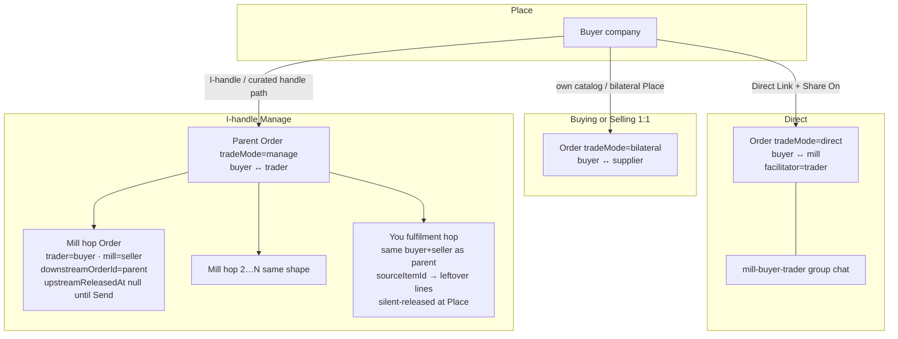

# Feature Completeness Review — Orders State & Waiting-Status Map

**Date:** 2026-11-04  
**Module / ask:** Investigation-only audit of every order type, DB status, transition, and waiting cue in the live implementation.  
**Anchors:** `docs/features/00-concepts.md`, `docs/features/orders.md`, Prisma `Order` / `OrderItem`, `apps/api/src/orders/*`, `apps/web/src/features/orders/*`, `packages/domain-types`  
**Disposition:** Proceed (audit only — **no** behaviour change)

> Source of truth for this document is **code**. Where `orders.md` / concepts disagree with code, both are listed and flagged **Conflict**.

---

## 0. Legend

| Kind | Meaning |
|------|---------|
| **DB status** | `Order.status` string (`requested` … `cancelled`) |
| **Line status** | `OrderItem.lineStatus` (`open` · `declined` · `confirmed` · `dispatched` · `delivered`) |
| **Hold flags** | `upstreamReleasedAt` (null = held from supplier), `passHeldAt` (trader froze pass-through) |
| **Derived UI** | Wait / Needs-you / glance cue — **not** stored on Order |
| **tradeMode** | `bilateral` · `manage` · `direct` |

Canonical enums: `packages/domain-types/src/enums.ts` (`OrderStatus`, `OrderTradeMode`, `OrderLineStatus`). Prisma stores them as `String` with comments (`apps/api/prisma/schema.prisma`).

---

## 1. Order type and record relationship diagram

### 1.1 Type matrix

| Type | Who creates | Two parties on that Order | Buying list | Selling list | Record(s) | Parent/child | Who acts next (after Place) |
|------|-------------|---------------------------|-------------|--------------|-----------|--------------|------------------------------|
| **Buying 1:1** | Buyer (or seller on-behalf) | Buyer ↔ supplier | Buyer | Supplier | One `bilateral` Order | None | Supplier Confirm / Decline (or buyer Accept quote if quoted) |
| **Selling 1:1** | Same record, seller view | Same | — | Seller | Same bilateral | None | Seller Confirm / Dispatch / Settle |
| **Direct** | Buyer Place (Direct Link) | Buyer ↔ mill; facilitator = pack/trader | Buyer | Mill (+ Shared for facilitator) | One `direct` Order + trio | None (no Send-hold) | Mill Confirm — trader does **not** Send |
| **I-handle parent** | Buyer Place handle / from-pack sheet 2 | Buyer ↔ trader | Buyer | Trader (**Trading** list row) | One `manage` Order | Parent of hops | Trader Send / Decline held mills; then wait mill / You |
| **Mill fulfilment hop** | Spawn at Place (`spawnHandleUpstreams` / from-pack) | Trader (buyer) ↔ mill (seller) | Trader (after Send) | Mill (after Send) | `manage` Order, `downstreamOrderId` = parent | Child of parent; lines `sourceItemId` → parent lines | Until Send: **invisible to mill**; after Send: mill Confirm |
| **You fulfilment child** | `spawnTraderOwnedFulfilmentHop` when leftover trader SKUs | Same buyer + seller as parent | **Buyer GET 404 / hidden** | Trader Pending Selling | Bilateral-shaped hop, silent `upstreamReleasedAt` set at create | Child; leftover `sourceItemId` | Trader Confirm / Dispatch on **You hop** (not parent operate) |
| **Mixed Place** | Two How many sheets | Sheet1 Direct mill(s); Sheet2 Manage parent + hops (+ You if leftover) | Per branch | Per branch | N Direct Orders + 1 Manage parent + mill hops + optional You | Directs **not** under Manage | Parallel: mill Confirm on Directs; trader Send on Manage |

**Refs:** `order.service.ts` `create` / `createFromPack` / `spawnHandleUpstreams` / `spawnTraderOwnedFulfilmentHop` / `sendUp`; `i-handle-desk.ts` `isTraderOwnedFulfilmentHop`, `isBuyerHiddenYouHop`; `orders.md` Dual trade · Mixed Place · You Selling hop.

---

## 2. Lifecycle transition table

### 2.1 Database `Order.status` values (actual)

| Status | Meaning |
|--------|---------|
| `requested` | Placed / waiting confirm (or quote path still open) |
| `confirmed` | Supplier locked supply (or buyer accepted quote) |
| `part_shipped` | Some qty shipped, remainder remains |
| `dispatched` | All shippable qty out |
| `delivered` | Legacy buyer deliver (still in enum + `deliver` API) |
| `settled` | Seller settled remaining/final |
| `declined` | Seller declined |
| `cancelled` | Buyer cancelled (or Direct→takeControl cancels Direct) |

**Serializer may rewrite display status** (`order.serializer.ts`): e.g. confirmed with shipped+remaining → show `part_shipped`; part_shipped with nothing left → `dispatched`. Pill text still comes from UI helpers.

### 2.2 Transitions (API)

Core writer: `OrderService.transition` — role + `from` whitelist.

| Current → Next | Trigger | Permission / condition | Who sees next |
|----------------|---------|------------------------|---------------|
| — → `requested` | `create` / `createBatch` / `createFromPack` | Buyer (or on-behalf); handle → `tradeMode=manage` + spawn hops | Both parties of that Order (mill hop **held** → mill cannot list) |
| `requested` → `requested` | `amend` | Buyer; `buyerCanAmend` (all open, no seller message yet) | Same; Manage syncs hops |
| `requested` → `requested` | `quote` | Seller; sets rates / `quotedAt` | Buyer can Accept quote |
| `requested` → `confirmed` | `confirm` / `decideLines` (some open kept) | Seller; ≥1 open confirmed | Buyer + pass-through to parent on mill hops |
| `requested` → `confirmed` | `acceptQuote` | Buyer; seller quote exists | Seller |
| `requested` → `declined` | `decline` / `decideLines` all declined / `millDecline` (held) | Seller / trader on held hop | Counterpart; parent may decline mapped opens |
| `requested`\|`confirmed` → `cancelled` | `cancel` | Buyer | Seller |
| `confirmed`\|`part_shipped`\|`dispatched` → rollup | `setLineSupply` / `setLineQuantity` | Seller; not settled; qty≥shipped; 0 qty = cant-supply path | Both; I-handle pass maps parent |
| `confirmed`\|`part_shipped` → `part_shipped`\|`dispatched` | `dispatch` | Seller; Manage parent **cannot** ship mill-mapped lines | Both; `passMillDispatchToParent` |
| `confirmed`\|`part_shipped` → `settled` | `settle` | Seller; shipped>0 & remaining>0 rules | Both; pass mill settle |
| `dispatched` → `delivered` | `deliver` | Buyer (legacy) | Seller |
| **no status change** | `sendUp` | Manage trader; sets `upstreamReleasedAt` | Mill can see hop; parent mill card un-held |
| **no status change** | `millPassHold` | Manage trader; set/clear `passHeldAt` | Trader desk “Held” |
| Direct `requested` → `cancelled` + new Manage | `takeControl` / `flipTicket` | Facilitator | New parent + held mill |

**Held / released is not a status.** `upstreamReleasedAt == null` + `downstreamOrderId` set ⇒ held (`isHeldFromSupplier` / mill desk `held`).

### 2.3 Docs vs code conflicts (lifecycle)

| Topic | Docs | Code | Flag |
|-------|------|------|------|
| Waiting until Send | “Mill tickets stay Waiting” (`orders.md` Me) | Hop stays `requested`; **held** = release flag, not status | Ambiguous wording — not a DB status named Waiting |
| Send quote everyday | Soft leftover | Detail dock `sendQuote: false`; Confirm path primary | Docs still describe quote sheet chrome |
| `delivered` | Rarely featured | Still in enum + `deliver` | Legacy path |
| Waiting for rates | Rejected Completeness 2026-11-04 | No `awaitingRates` field; dead `nextOrderAction` copy remains | See §5 |

---

## 3. Waiting-status matrix

### 3.1 Needs-you (actor must act) — derived

| Exact UI | Helper | Type / direction | Status | Held? | Who acts | Clears when | Surfaces |
|----------|--------|------------------|--------|-------|----------|-------------|----------|
| `Needs you Accept & forward` | `traderIHandleNeedsYouLabel` / `orderNeedsYouLabel` | Manage selling parent | `requested` + held mill | yes | Trader Send | `sendUp` / all held gone | List glance → verb **Forward** |
| `Needs you Confirm` | `orderNeedsYouLabel` | Selling bilateral (or sellerNeedsRate / needsQuotePass) | `requested` | n/a | Seller | Confirm / decideLines | List Confirm |
| `Needs you Accept quote` | same | Buying | `requested` + quote | n/a | Buyer | acceptQuote | List |
| `Needs you Dispatch` | same | Selling | confirmed / part_shipped needs ship | n/a | Seller | dispatch | List |
| `Needs you Settle` | same | Selling | canSettle | n/a | Seller | settle | List |
| `Needs you` | fallback | matchesNeeds | varies | | | | List |

**Refs:** `tradeNeedsYouLabel.ts`, `iHandleDesk.ts` `traderIHandleNeedsYouLabel`, `tradeListGlance.ts`.

### 3.2 Idle waits (counterpart / mill) — derived

| Exact UI | Helper | Type | Status | Held/released | Expected actor | Clears | Surfaces | Dup? |
|----------|--------|------|--------|---------------|----------------|--------|----------|------|
| `Waiting: supplier` | `tradeListWaitingCue` / `orderTicketWaitingCue` | Buying any idle; I-handle list parent idle | pending | — | Supplier / mill side | Their Confirm/Dispatch or your Needs-you | List clock; 1:1 dock; non–Manage party | Same string, many contexts |
| `Waiting: buyer` | same | Selling idle | pending | — | Buyer | Accept quote / settle path | List; 1:1 dock | |
| `Your move: Send to {mill}` | `traderDeskNextAction` | Manage parent | `requested` | 1 held | Trader | Send | Detail dock / ticket wait (not list) | |
| `Your move: Send mill lots` | same | Manage | `requested` | 2+ held | Trader | Send all | Detail | |
| `Waiting on {mill} to confirm` | same | Manage | `requested` | released, mill `requested` | Mill | Mill confirm | Detail dock | **vs** card / hop wording |
| `Waiting on mills to confirm` | same | Manage | `requested` | 2+ released requested | Mills | Confirms | Detail | |
| `Waiting on {mill} to dispatch` | same | Manage | confirmed / part_shipped | mill needs dispatch | Mill | Dispatch | Detail | **vs** card |
| `Waiting on mills to dispatch` | same | Manage | same | 2+ | Mills | | Detail | |
| `Your move: Confirm your lots` | `youFulfilmentDeskCue` | Manage + You hop | parent `requested`, You `requested` | You silent-released | Trader on You hop | Confirm on You | Detail wait | |
| `Waiting on You to dispatch` | same | Manage + You | confirmed/part_shipped | | Trader You hop | Dispatch You | Detail | |
| `Buying #{TAIL} · waiting to confirm` | `millFulfilmentOpenSubtitle` + `millFulfilmentWaitLabel` | Mill card | hop `requested` | released | Mill | Confirm | Mill card open row | Unified confirm verb (`2026-11-04-mill-wait-confirm-verb`) |
| `Buying #{TAIL} · waiting to dispatch` | same | Mill card | needs dispatch | released | Mill | Dispatch | Mill card | |
| `Buying #{TAIL} · Held` | same + `passHeld` | Mill card | released + passHeld | passHeld | Trader Resume | Resume | Mill card | |
| `Waiting for {mill} to confirm` | `millHopAcceptWaitLabel` | Trader opens mill hop | hop `requested` | released | Mill | Confirm | Mill hop **dock** | Same confirm verb as parent/card |
| `Dispatched · complete` / `Settled · complete` | `traderDeskNextAction` | Manage | terminal | | — | — | Detail wait (also pill-ish) | Overlaps status chrome |

**Not found as live UI wait:** `Waiting for rates`, `awaitingRates`, `for rates` on OrderDetailPage.  
**Dead leftover:** `nextOrderAction` in `packages/domain-types/src/order-events.ts` still has “for rates” / “send rates” strings; `orderDetailNextCue` only used in specs.

### 3.3 Status pills (not waits)

| Helper | `requested` | `dispatched` | `settled` | Notes |
|--------|-------------|--------------|-----------|-------|
| `statusLabel` (`lib/status.ts`) | Placed | Dispatched · complete | Settled · complete | Kit default |
| `tradeListStatusLabel` | Placed | Dispatched | Settled | Detail header / You card — **no · complete** |

Orders **list** does not paint StatusPill; uses glance Needs-you or Waiting clock.

### 3.4 Explicit distinctions requested

| Concept | Supported? | How |
|---------|------------|-----|
| Waiting for buyer | Yes | `Waiting: buyer` (selling idle) |
| Waiting for trader | Partial | Needs-you Forward / Confirm your lots / Send to mill — not a single “Waiting: trader” string |
| Waiting for supplier/mill confirm | Yes | Unified **confirm** on parent / card / hop dock (list stays `Waiting: supplier`) |
| Waiting for mill release / Send | Yes | Needs you Accept & forward + Your move: Send…; held cards show Send not wait |
| Waiting for dispatch | Yes | Waiting on {mill}/mills/You to dispatch; card `waiting to dispatch` |
| Waiting for settlement | Via Needs you Settle | No idle “Waiting: settle” string found |
| Waiting for rates | **No live UI** | Rejected product; dead `nextOrderAction` only |

---

## 4. Scenario walkthroughs

### A. Buyer places normal order with supplier (bilateral)

1. Buyer Place → Order `bilateral` `requested`, lines `open`.  
2. Buyer: Buying list; Supplier: Selling.  
3. Wait: buyer `Waiting: supplier`; seller Needs you Confirm (or idle Waiting: buyer after?). Seller needs confirm → Needs you Confirm.  
4. Records: one Order.

### B. Supplier confirms

1. Seller `confirm` / `decideLines` → `confirmed`, opens → `confirmed`.  
2. Wait clears Needs you Confirm; buyer may see Waiting: supplier until dispatch needs flip to seller Dispatch.  
3. Dock: seller Dispatch when remaining.

### C. Supplier changes qty before / after confirm

- **Before:** Confirm sheet / decideLines qty|rate on open lines.  
- **After:** `setLineQuantity` while confirmed / part_shipped / dispatched; floor shipped; not buyer. Timeline Updated qty.

### D. Buyer amends qty before / after confirm

- **Before:** `amend` while `buyerCanAmend` (requested, all open, no seller message).  
- **After:** **API rejects** buyer qty change (seller-only `setLineQuantity`). UI should match — flag if UI still offers Edit after lock.

### E. Buyer places Direct order

1. Direct Link + Share → `tradeMode=direct`, mill ticket, trio.  
2. Mill sees Selling immediately (no Send).  
3. Wait: buyer Waiting: supplier; mill Needs you Confirm.  
4. Trader: Shared / facilitator — not Send desk.

### F. I-handle one mill

1. Place handle → parent `manage` `requested` + mill hop held (`upstreamReleasedAt` null).  
2. Buyer sees parent Buying; trader Selling Trading row; mill **cannot** list hop.  
3. Wait list: Needs you Accept & forward → Forward. Detail: Send on mill card; ticket wait silent while held.  
4. `sendUp` → released; mill sees hop; parent wait → Waiting on {mill} to confirm; card `Buying # · waiting to confirm`.

### G. I-handle multiple mills

1. Parent + N held hops.  
2. Wait: Your move: Send mill lots / Send all dock; per-card Send.  
3. After some sent: remaining held still Needs Forward; released mills enter confirm wait count.

### H. Trader Send / release

1. `sendUp` patches qty/rate optional; sets `upstreamReleasedAt`.  
2. Status stays `requested` on hop.  
3. Clears held; mill notified/listable.

### I. Mill confirms / qty / can’t supply

1. Mill `confirm` / `decideLines` / `setLineSupply` on hop.  
2. Pass-through updates parent mapped lines (`sourceItemId`).  
3. Parent wait shifts to dispatch or You cue when mills quiet.

### J. You fulfilment child

1. Leftover trader SKUs → You hop silent-released.  
2. Buyer cannot open You hop.  
3. Trader Confirm/Dispatch on You hop; parent shows You card + `Your move: Confirm your lots` / `Waiting on You to dispatch`.  
4. Parent must not look Dispatched while any parent line still open (heal rules).

### K. Mixed Place

1. Sheet1 Direct mill(s) → Direct Orders.  
2. Sheet2 Manage parent + I-handle hops + optional You.  
3. Parallel lifecycles; Direct never under Manage Send.

### L. Partial then later dispatch

1. `dispatch` → `part_shipped` if remainder; else `dispatched`.  
2. Further dispatch / Dispatch more.  
3. Waits: Needs you Dispatch / Waiting on mill to dispatch.

### M. Decline / cancel / hold / resume

| Action | Effect |
|--------|--------|
| Mill / seller decline | → `declined`; held `millDecline` may mark parent opens |
| Buyer cancel | → `cancelled` from requested/confirmed |
| Pass Hold | `passHeldAt` set; card `Held`; no status change |
| Resume | clear `passHeldAt` |

---

## 5. Inconsistencies and risks

### Confirmed defects / high risk

1. **~~Three wordings for “released mill still requested”~~ — fixed**  
   - Parent / card / hop dock all use **confirm** (`2026-11-04-mill-wait-confirm-verb`). List remains generic `Waiting: supplier`.

2. **List vs detail on Manage after Send**  
   - List: generic `Waiting: supplier`  
   - Detail: mill-named confirm/dispatch  
   Risk: list under-informs which mill.

3. **Dead rates-wait copy still in domain-types**  
   - `nextOrderAction` “Waiting on {who} for rates” — not wired to OrderDetailPage but can confuse future call sites / tests named “mill rates”.

4. **`FulfilmentDeskCard.waitLabel` unused**  
   - Wait folded into `openSubtitle`; JSDoc still says “rates / confirm / dispatch”.

5. **Status pill complete suffix drift**  
   - `statusLabel`: `Dispatched · complete`  
   - `tradeListStatusLabel`: `Dispatched`  
   Same terminal state, two chrome languages.

6. **Docs “Waiting” vs held flag**  
   - Product copy says mill tickets “stay Waiting until Send”; code uses `requested` + `upstreamReleasedAt`.

### Ambiguities / unanswered

- Is buyer **Edit** fully gated after confirm in UI everywhere? (API yes.)  
- When parent is `part_shipped` because mill shipped but You still open — exact list glance for trader?  
- `delivered` — still product-facing or API-only legacy?  
- Multi-mill Forward-per-note (`forwardedTo`) planned separately — not part of wait map.

### Matching risk

- Stable identity: `sourceItemId`.  
- Create-time `claimParentItemId` may use productId/name; amend sync prefers sourceItemId.  
- `millDecline` held path may still touch parent opens by **productId** (API report) — **flag** vs platform “sourceItemId only” Completeness.

### Legacy awaitingRates

- **No** DB/API field.  
- Live mill/hop UI explicitly does not wait for rates (Completeness 2026-11-04).  
- Leftover: comments + dead `nextOrderAction` + some spec titles.

---

## 6. File / function index

| Area | Path | Symbols |
|------|------|---------|
| Enums | `packages/domain-types/src/enums.ts` | `OrderStatus`, `OrderTradeMode`, `OrderLineStatus` |
| Schema | `apps/api/prisma/schema.prisma` | `Order.status`, `downstreamOrderId`, `upstreamReleasedAt`, `passHeldAt`, `sourceItemId` |
| Lifecycle | `apps/api/src/orders/order.service.ts` | `create`, `amend`, `confirm`, `decideLines`, `acceptQuote`, `quote`, `dispatch`, `settle`, `sendUp`, `millDecline`, `millPassHold`, `setLineQuantity`, `setLineSupply`, `transition`, `spawnHandleUpstreams`, `spawnTraderOwnedFulfilmentHop` |
| Desk helpers (API) | `apps/api/src/orders/i-handle-desk.ts` | `claimParentItemId`, `matchParentItemId`, `isTraderOwnedFulfilmentHop`, `shouldPassThrough` |
| Hold | `apps/api/src/orders/orderHold.ts` | `isHeldFromSupplier`, `isBuyerHiddenYouHop` |
| Serialize | `apps/api/src/orders/order.serializer.ts` | `toOrderView` status heal |
| GET desks | `order.service.ts` `get` / `buildMillDesks` / `findYouFulfilment` | |
| Web waits | `iHandleDesk.ts` | `traderDeskNextAction`, `youFulfilmentDeskCue`, `millFulfilmentWaitLabel`, `millHopAcceptWaitLabel`, `orderActionDock` |
| Ticket wait | `orderTicketChrome.ts` | `orderTicketWaitingCue` |
| List | `tradeListGlance.ts`, `tradeNeedsYouLabel.ts`, `tradeListProtocol.ts` | |
| Pills | `lib/status.ts` `statusLabel` | |
| Dead rates copy | `packages/domain-types/src/order-events.ts` | `nextOrderAction` |
| Product docs | `docs/features/orders.md`, `00-concepts.md` | Dual trade, Me/I-handle, Mixed Place, You hop |

---

## 7. Concise summary

### All actual DB statuses
`requested` · `confirmed` · `part_shipped` · `dispatched` · `delivered` · `settled` · `declined` · `cancelled`

### All live waiting / needs-you families
- Needs you: Accept & forward · Confirm · Accept quote · Dispatch · Settle · bare Needs you  
- Idle: Waiting: supplier/buyer · Your move: Send… · Waiting on {mill\|mills\|You} to confirm/dispatch · Confirm your lots · Buying # · waiting to confirm/dispatch/Held · Waiting for {mill} to confirm  
- Complete cues: Dispatched · complete / Settled · complete (desk)

### What triggers / who acts / what clears (pattern)
| Wait family | Trigger | Actor | Clears |
|-------------|---------|-------|--------|
| Needs Forward / Send | Held mill on Manage | Trader | `sendUp` |
| Waiting supplier / mill confirm | Released hop or bilateral requested | Mill/supplier | Confirm |
| Waiting dispatch | Confirmed with remaining | Seller/mill/You | Dispatch |
| Waiting buyer | Selling idle | Buyer | Accept quote / next buyer verb |
| Needs Confirm/Dispatch/Settle | Seller capability flags | Seller | Matching POST |

### Highest-risk inconsistencies
1. ~~**confirm vs accept** triple wording~~ — **resolved** (confirm everywhere on Manage card/hop/parent).  
2. **List generic Waiting: supplier** vs **detail mill-named** waits on Manage.  
3. **Dead rates-wait strings** in `nextOrderAction` vs product “no rates wait”.  
4. **Docs “Waiting until Send”** vs **held flag + status requested**.  
5. Possible **productId** decline mapping on held millDecline vs **sourceItemId** platform rule.

---

## Sign-off

Required gaps closed or deferred in writing: Yes (audit)  
Ready for implementation / fixes: **No** — stop after audit; fixes need separate Completeness Proceed per item.  
